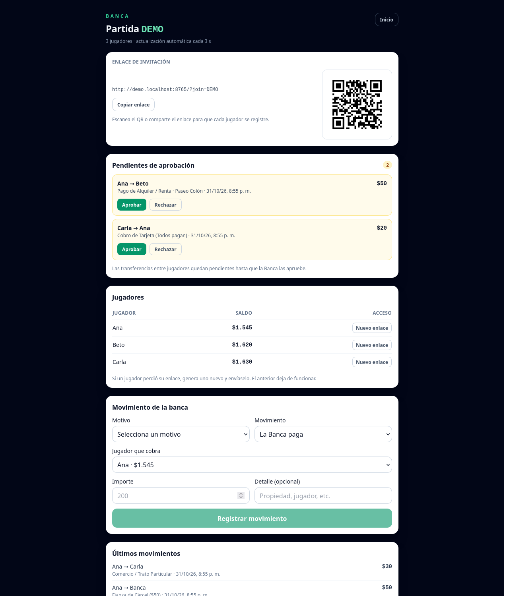
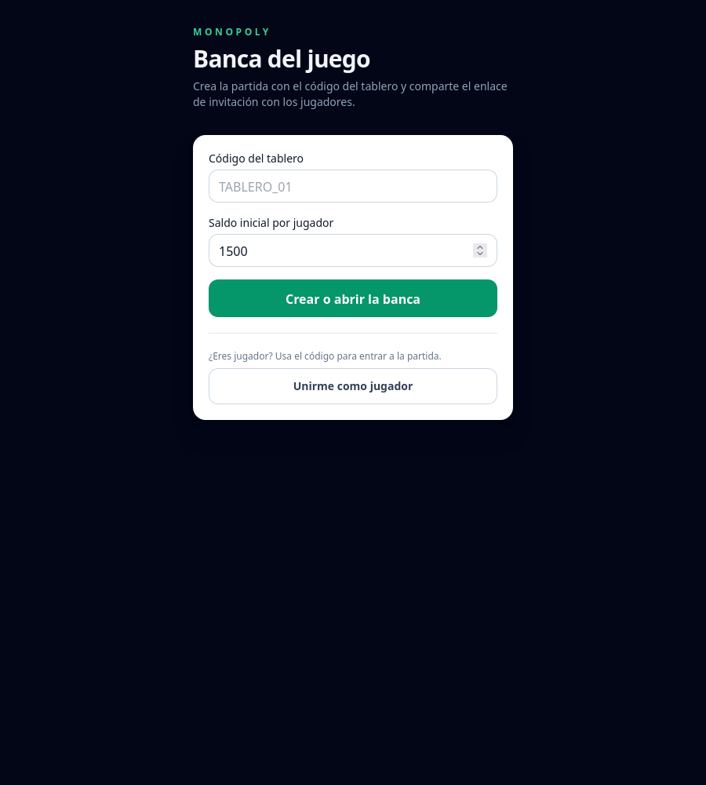
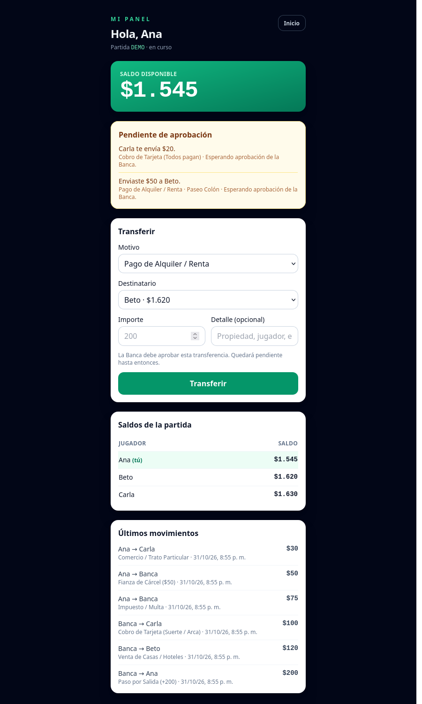

# Monopoly Bank App

Banca web para partidas de Monopoly. Permite crear una partida, invitar jugadores con un enlace o código QR, registrar pagos y cobros, y aprobar las transferencias entre jugadores antes de mover el dinero.



## Características

- Partida identificada por un código de tablero y saldo inicial configurable.
- Panel de Banca con enlace de invitación, QR, jugadores, saldos, movimientos y solicitudes pendientes.
- Panel de jugador con saldo, transferencias, motivos de pago, historial y solicitudes pendientes.
- Motivos agrupados en tres flujos: Banca → Jugador, Jugador → Banca y Jugador → Jugador.
- Las transferencias entre jugadores iniciadas por un jugador quedan pendientes hasta que la Banca las apruebe o rechace.
- Recuperación de acceso: el navegador recuerda el jugador en el mismo dispositivo y la Banca puede generar un enlace nuevo (con QR) si se perdió.
- Actualización automática cada 3 segundos mediante polling.
- Sin framework, sin compilación y sin dependencias de frontend externas.

## Capturas

| Inicio | Banca |
| --- | --- |
|  |  |



## Stack

- **Backend:** PHP 8 con PDO.
- **Base de datos:** MySQL 8 / InnoDB.
- **Frontend:** HTML, JavaScript vanilla y Tailwind CSS servido localmente.
- **QR:** `qrcode-generator` (MIT), incluido en `assets/js/qrcode.js`.
- **Despliegue:** Apache con PHP; no requiere `npm`, `composer` ni paso de compilación.

## Estructura

```
index.php                  Vista única según parámetros de la URL
api/
  conexion.php             PDO y utilidades JSON
  game.php                 Crear o abrir partida
  join.php                 Registrar jugador
  transfer.php             Transferencias y solicitudes pendientes
  status.php               Estado de la partida para el polling
  approve.php              Aprobar una solicitud pendiente
  reject.php               Rechazar una solicitud pendiente
  regenerate.php           Generar un enlace nuevo para un jugador
  seeder.php               Aplicar el esquema por CLI
assets/
  tailwind.js              Tailwind local
  js/common.js             Utilidades y vistas de inicio/alta
  js/bank.js               Panel de Banca
  js/player.js             Panel de jugador
  js/reasons.js            Catálogo de motivos de pago y cobro
  js/qrcode.js             Generador de QR local
sql/schema.sql             Esquema de la base de datos
scripts/check.sh           Verificaciones estáticas
scripts/smoke.py           Pruebas HTTP
deploy.sh                  Despliegue por rsync
```

## Puesta en marcha

### Requisitos

- PHP 8.1 o superior con `pdo_mysql` y `mbstring`.
- MySQL 8 o superior.
- Apache (o cualquier servidor que ejecute PHP) con HTTPS recomendado.

### Pasos

1. Crear la base de datos y el usuario:

   ```bash
   mysql -u root -p -e "CREATE DATABASE monopoly CHARACTER SET utf8mb4 COLLATE utf8mb4_unicode_ci;"
   mysql -u root -p -e "CREATE USER 'monopoly_user'@'localhost' IDENTIFIED BY 'CAMBIAR_PASSWORD';"
   mysql -u root -p -e "GRANT ALL PRIVILEGES ON monopoly.* TO 'monopoly_user'@'localhost'; FLUSH PRIVILEGES;"
   ```

2. Crear la configuración local:

   ```bash
   cp api/config.example.php api/config.php
   ```

   Editar `api/config.php` con las credenciales reales. Este archivo no se versiona.

3. Aplicar el esquema:

   ```bash
   mysql -u monopoly_user -p monopoly < sql/schema.sql
   ```

4. Configurar el servidor web con el proyecto como `DocumentRoot`.

   El servidor debe bloquear el acceso HTTP a `config.php`, a los archivos `.sql`, `.md` y `.txt`, y a los archivos ocultos.

5. Abrir la aplicación en el navegador, ingresar un código de tablero y crear la partida.

## Comandos

```bash
# Verificaciones estáticas
./scripts/check.sh
# o
make check

# Pruebas HTTP no mutantes
python3 scripts/smoke.py --base-url https://tu-dominio.example

# Flujo completo: crea una partida de prueba y deja datos
python3 scripts/smoke.py --base-url https://tu-dominio.example --full

# Despliegue (requiere SSHPASS exportado y ajustar HOST/DEST en deploy.sh)
./deploy.sh
```

`check.sh` valida JavaScript con `node --check`, scripts de shell, Python y PHP (solo si `php` está disponible). No utiliza Docker.

## API

| Método | Ruta | Descripción |
| --- | --- | --- |
| POST | `/api/game.php` | Crea o recupera una partida por código. |
| POST | `/api/join.php` | Registra un jugador y devuelve su token. |
| POST | `/api/transfer.php` | Ejecuta una transferencia o crea una solicitud pendiente. |
| GET | `/api/status.php` | Devuelve partida, jugadores, movimientos y pendientes. |
| POST | `/api/approve.php` | Aprueba una solicitud pendiente. |
| POST | `/api/reject.php` | Rechaza una solicitud pendiente. |
| POST | `/api/regenerate.php` | Genera un enlace nuevo para un jugador. |
| CLI | `php api/seeder.php` | Aplica `sql/schema.sql`. |

Las respuestas usan el formato `{"ok": true, ...}` o `{"ok": false, "error": "..."}`.

## Modelo de datos

- `games`: código de partida, saldo inicial y estado.
- `players`: jugador, token de acceso, saldo y partida.
- `transactions`: movimientos confirmados. Un `NULL` en origen o destino representa a la Banca.
- `pending_transfers`: solicitudes entre jugadores pendientes de aprobación.

## Seguridad

- No hay cuentas de usuario. La Banca se protege con el código de partida y el jugador con un token bearer.
- No compartas el enlace personal de un jugador: quien lo tenga puede mover su dinero.
- Usa HTTPS en producción.
- Mantén `api/config.php` fuera del repositorio y con permisos restrictivos en el servidor.

## Créditos

- Generación de QR: [qrcode-generator](https://github.com/kazuhikoarase/qrcode-generator) de Kazuhiko Arase, licencia MIT.
- Tailwind CSS se sirve localmente desde `assets/tailwind.js`.
